# knowledge-gate

**AI engineering talks come out faster than I can watch them. Open Gemma models watch them for me and add only
what is new to my own notes, and my notes never leave my laptop.**

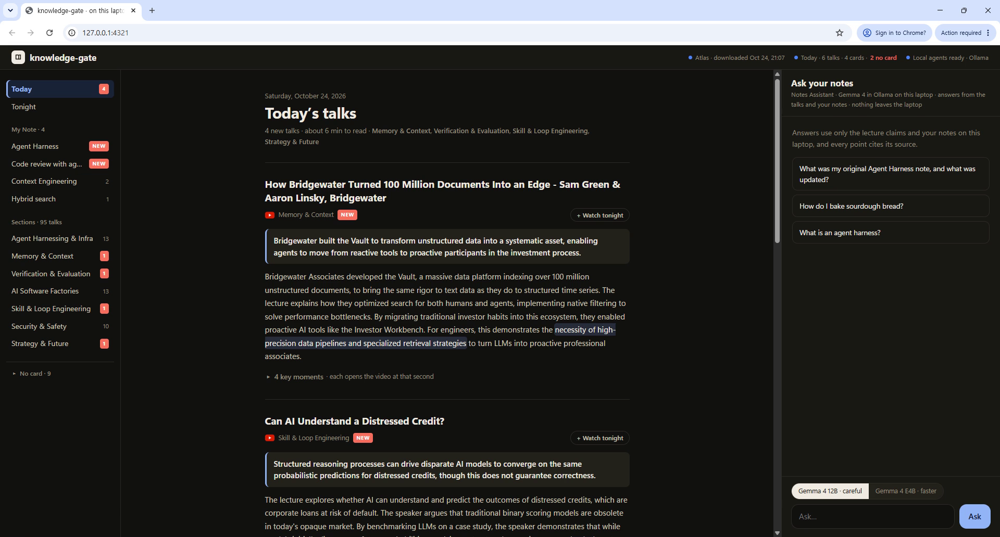

*The morning page at `http://127.0.0.1:4321` (Oct 22). Speaker names are blurred in this screenshot.*

> The project's working name was lecture-gate. Internal names keep it: the Atlas database `lecture_gate`, the Sentry
> project, the Temporal task queue, the Backboard assistant and the `lg-*` services. Some screenshots show that name.

## At a glance

| | |
|---|---|
| **What it does** | A new AI talk is uploaded → the server turns it into a checked card → every morning my laptop adds only what is new to my own notes → I can ask, by typing or by voice. |
| **Gemma 4** | Gemma 4 31B writes the cards and joins concepts on the server; Gemma 4 12B and EmbeddingGemma in Ollama merge my notes and answer on the laptop. [The AI agents](#the-ai-agents-one-job-each) |
| **Never pretends** | Every quote is checked word for word by code; a failed check loops back, becomes a lesson, and a tested rule. If something is not in my notes, it says so. [What happens when a check fails](#what-happens-when-a-check-fails) |
| **Private** | My notes never leave the laptop; only public talk data goes through MongoDB Atlas. [Privacy](#privacy) |
| **Voice** | Optional: with `--stt whisper`, Whisper runs on the laptop; spoken answers come from my notes and the talks. With `--voices elevenlabs`, ElevenLabs voices the answers and the morning briefing, and plays calm music when I say I'm tired. [Ask by voice](#ask-by-typing-or-by-voice) |
| **Real tools, real runs** | Mastra on Temporal, MongoDB Atlas Vector Search, Sentry, SerpApi, Backboard, DigitalOcean. [Screenshots](#the-tools-in-real-use) |
| **Open source** | MIT. [Run it](#run-it) |

## The tools in real use

Screenshots from my own accounts, taken while the system ran on real talks (Oct 21–22). More in [`docs/evidence/`](docs/evidence/).

<table>
<tr>
<td width="50%">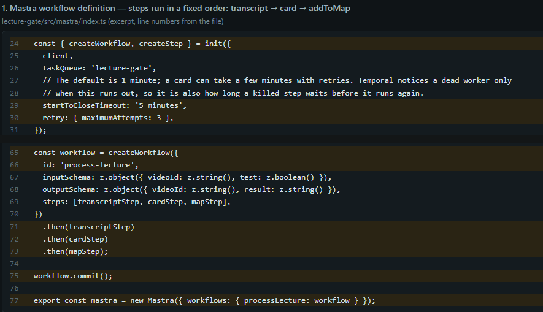</td>
<td width="50%">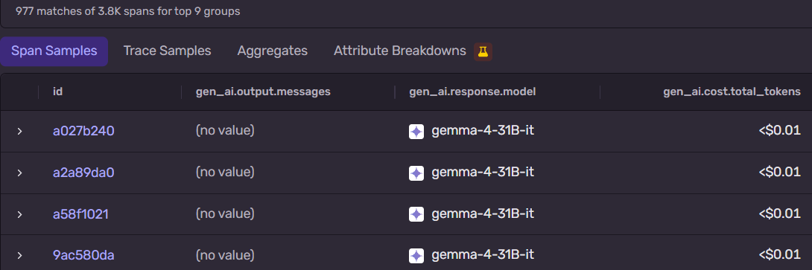</td>
</tr>
<tr>
<td><em><b>Mastra + Temporal</b>: the workflow in <code>src/mastra/index.ts</code>, 5 minute timeout, 3 attempts, three steps in a fixed order.</em></td>
<td><em><b>Sentry</b>: 977 model calls traced as <code>gen_ai</code> spans, each Gemma 4 31B card call under $0.01. The output column is empty because prompts and outputs are never sent.</em></td>
</tr>
<tr>
<td>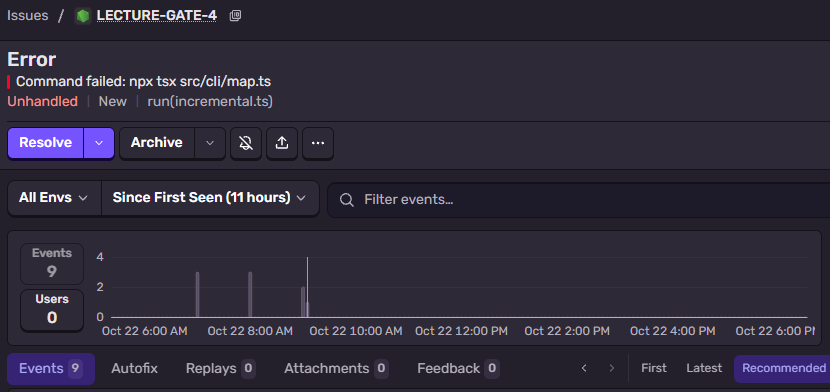</td>
<td>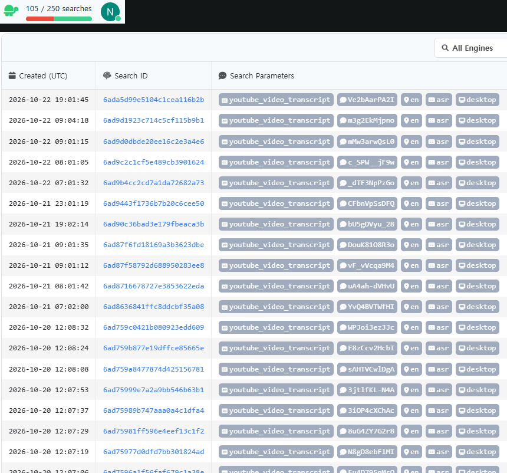</td>
</tr>
<tr>
<td><em><b>Sentry</b>: a real incident, LECTURE-GATE-4. The map step failed because I had regenerated the map files as root; a <code>chown</code> fixed it.</em></td>
<td><em><b>SerpApi</b>: one <code>youtube_video_transcript</code> search per talk, cached on disk; 105 of the month's 250 free searches used.</em></td>
</tr>
<tr>
<td>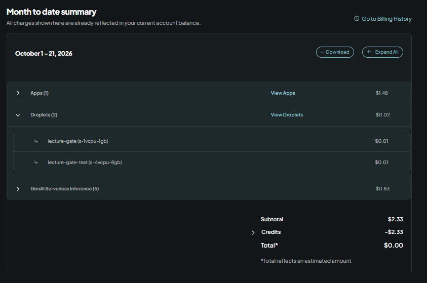</td>
<td></td>
</tr>
<tr>
<td><em><b>DigitalOcean</b>, Oct 1–21: knowledge-gate is GenAI Serverless Inference $0.83 + Droplets $0.02 ("Apps $1.48" is another project). Credits paid it all: total $0.00.</em></td>
<td></td>
</tr>
</table>

## The problem

A few YouTube channels I follow (AI Engineer conference talks and two others, see `src/lib/channel.ts`) upload
new talks almost every day. I keep my own notes on topics like "Agent Harness" or "Hybrid search". What I actually
want each morning is not "here are five more videos", but: *what did these talks say that my notes do not say yet,
and where exactly did they say it?*

Two rules shaped the design:

1. **Nothing is shown that the talk did not say.** A model can paraphrase, but every quote must be found word for
   word in the transcript, and code, not the model, checks that.
2. **My notes stay on my laptop.** Public talks can be processed in the cloud. My notes, which also hold what I
   have not figured out yet, are read only by a model running locally in Ollama.

## How it works


<details>
<summary>The same flow as a diagram with the step names in the code</summary>

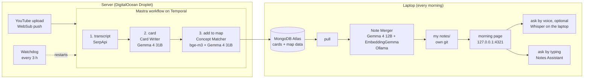

</details>

Only public talk data goes through Atlas (`src/cli/sync.ts`). The notes folder is gitignored and has its own local
git, so every morning merge can be undone.

### On the server

When a subscribed channel uploads a talk, YouTube's WebSub hub pushes a notification to `src/server/webhook.ts`,
which starts the `processLecture` workflow (`src/mastra/index.ts`). It has three steps, and each step is a Temporal
activity, so a run survives a killed worker and continues at the unfinished step:

1. **transcript**: SerpApi fetches the YouTube transcript (cached on disk, so a rerun spends no search).
2. **card**: the Card Writer turns the transcript into a card (see below).
3. **addToMap**: the Concept Matcher joins the talk's concepts to the shared map, the talk is put in one of the
   7 categories (Gemma 4 31B, with code checking the category rules), and everything is pushed to MongoDB Atlas.

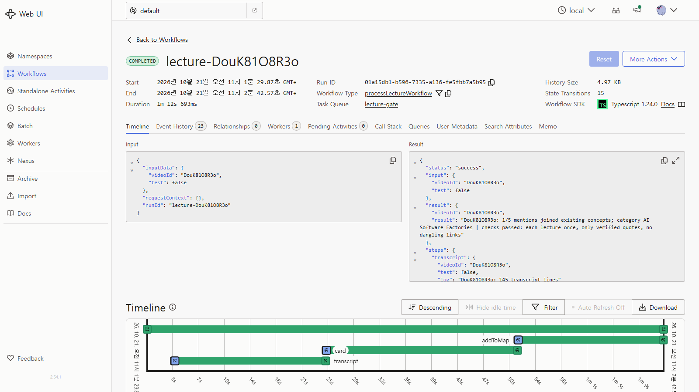

*One real run in the Temporal UI (Oct 21): transcript → card → addToMap, 1 min 12 s in total.*

**Embeddings.** Each concept mention is stored in Atlas (`lecture_gate.mentions`) as a 1024-number bge-m3 vector, and
the `vec` Vector Search index compares them by cosine. The Concept Matcher takes the 6 closest mentions from past
talks, and Gemma 4 31B decides whether the new one is one of them.

<table>
<tr>
<td width="50%">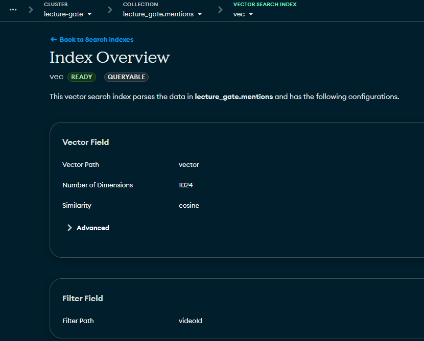</td>
<td width="50%">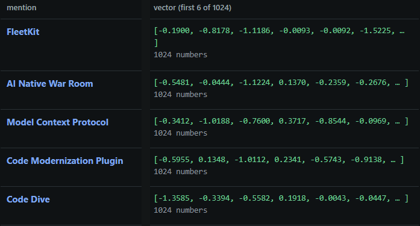</td>
</tr>
<tr>
<td><em>The <code>vec</code> index: 1024 dimensions, cosine, filter on <code>videoId</code>.</em></td>
<td><em>The real vectors of one talk's 5 concepts (first 6 of 1024 numbers shown).</em></td>
</tr>
</table>

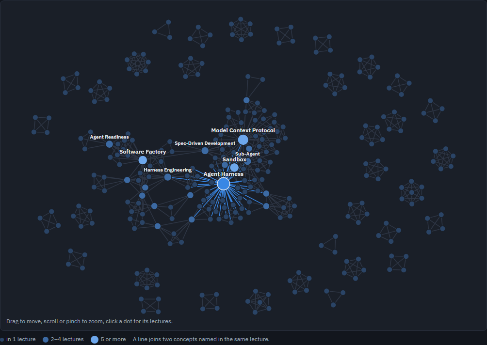

*The shared concept map built from public talks (Oct 22, 72 talks at the time). Each dot is a concept; a line joins
two concepts named in the same talk. The largest dot is Agent Harness.*

### On the laptop

`npm run morning` (`src/cli/morning.ts`) runs three steps; on Windows, `deploy/morning-task.ps1` runs it from Task
Scheduler at log-in:

1. pull the cards and map data from Atlas,
2. merge the new talks into my notes with the local Note Merger,
3. mark the key phrases of each new summary for the morning page.

Then `npm run web` serves the morning page on `127.0.0.1` only.

## The AI agents, one job each

| Agent | Where | Model | Job |
|---|---|---|---|
| **Card Writer** | server | Google Gemma 4 31B (DigitalOcean serverless inference) | Turns a transcript into a card: a one-line conclusion, a short summary, and claims, each with a word-for-word quote and the second it was said. |
| **Quote Checker** | server | none, plain code | Looks for each quote word for word in the transcript. Only quotes that are found are shown. |
| **Concept Matcher** | server | BAAI bge-m3 embeddings + Atlas Vector Search + Gemma 4 31B | Finds the 6 closest existing concept mentions and decides whether a new mention is one of them or a new concept, so ten talks about one idea become one concept page. |
| **Note Merger** | laptop | Gemma 4 12B + EmbeddingGemma (Ollama) | Finds the note each new claim belongs to and adds only what the note does not already say. |
| **Highlighter** | laptop | Gemma 4 12B (Ollama) | Picks one or two key phrases per summary for the green marks on the page. |
| **Notes Assistant** | laptop | Gemma 4 12B or E4B (Ollama) | Answers typed questions from the talks and my notes, with sources. |

There is also a nightly **Rule Tester** (`src/agent/verify.ts`, a systemd timer at 03:00 UTC, outside Mastra): it turns
recorded mistakes into candidate prompt rules and keeps a rule only if runs with it are at least as good as runs
without it. Kept rules are stored in Backboard, where the card and map prompts read them.

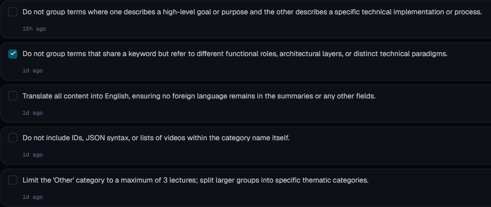

*Rules the Rule Tester kept, as stored in Backboard.*

### What happens when a check fails

The models are never trusted on their own word. Code checks each answer, and a failure has a defined next step:

- **Card checks** (`src/lib/card.ts`): a card must pass the schema, be in English only, have one chapter per YouTube
  chapter, and have the right number of claims (one per 5 minutes of talk, 3 to 12). If a check fails, the Card
  Writer gets its own card back with the defects listed and revises it, up to 3 attempts. Only an answer that is not
  valid JSON is made again from scratch. Every failed attempt is written to `data/lessons.jsonl` for the Rule Tester.
- **Quotes**: a quote that is not found word for word in the transcript is not shown. The claim can still be used,
  and the merge marks it "(quote not verified)".
- **Concept matching**: code keeps the model's answer only if it names one of the candidate concepts; otherwise the
  mention stays a new concept and a lesson is recorded.
- **Workflow steps**: Temporal retries a failed step up to 3 times (5 minute timeout per step). In a test I
  force-killed the worker during `addToMap`: transcript and card did not run again, and the second attempt of
  `addToMap` gave the same result as before ("concepts 4/4 same; category same"). See the screenshot below.
- **Watchdog** (`src/cli/watchdog.ts`, every 3 hours): renews the YouTube subscriptions, reads each channel's
  feed to catch uploads the push missed, and restarts any talk that is not on the map yet. A talk that has a card but
  no category is restarted too; the transcript and card are cached, so only `addToMap` runs again. After 3 restarts
  it gives up on that talk, so a talk with no transcript does not use SerpApi searches forever.
- **Note merge**: if the local model's verdict for a claim is missing or broken, the claim is held, not added, and
  the talk is tried again next morning.
- **Highlights**: a marked phrase is kept only if it appears word for word in the summary.

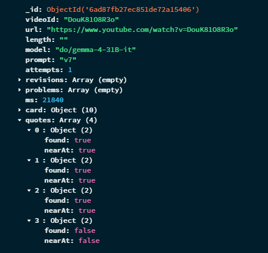

*A card in Atlas (Oct 21, prompt v7): 3 of 4 quotes were found in the transcript, so only those 3 are shown.*

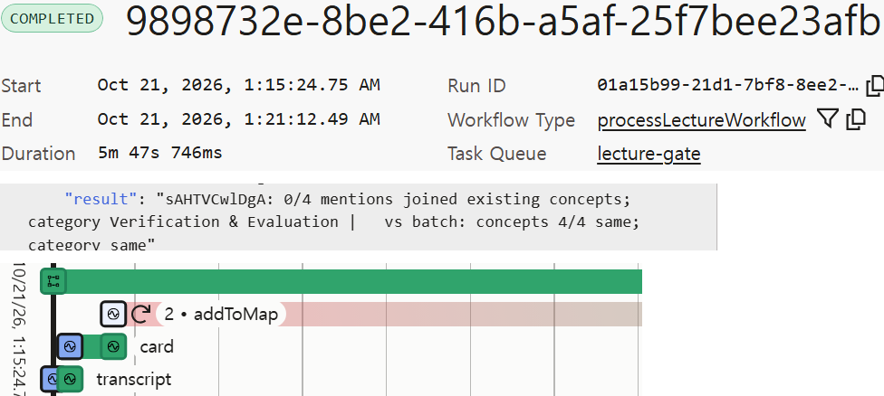

*The kill test in Temporal (Oct 21): `addToMap` on attempt 2, the run completed in 5 min 47 s.*

## My note, before and after

The Note Merger works on my own Markdown notes. For each new claim it picks at most one note (a note named after
one of the claim's concepts, else a note whose text names one, else the closest note by EmbeddingGemma similarity).
Then the local model says whether the claim is **known**, **new** or **unrelated**. If it says "known", it must copy
the sentence from my note that already says it, and code checks that sentence is really there; otherwise the claim
counts as new.

New claims are appended under `## From lectures`, with the quote (when verified) and a link to the second in the
video. **Nothing above that heading is changed, and code checks this.** Claims that fit none of my notes go to a
note for the talk's category (`notes/sections/`). If a claim corrects a sentence I wrote, it becomes an edit
proposal that I can approve on the page; otherwise my sentences are never touched.

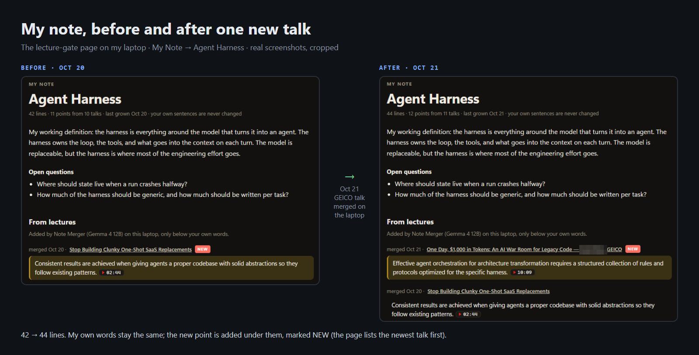

*Real screenshots, placed side by side (Oct 20 → Oct 21). "Agent Harness" is one of the sample notes in
`notes.sample/`.*

A claim that seems to answer a question I asked earlier and that was not in my notes (see below) is marked 🔔
"possibly answers your question" in `notes/00 Morning.md`.

## The morning page

`npm run web` serves one page on `http://127.0.0.1:4321`. It shows:

- **Today's talks**: for each new talk, the one-line conclusion, the summary with the Highlighter's marks, and the
  key moments, each opening the video at that second,
- **Your notes**: what the Note Merger added to which note this morning,
- **Sections**: the 7 categories of the concept map,
- **Ask your notes**: the chat panel on the right.

The server listens on 127.0.0.1 only, and the page itself loads nothing from the internet.

## Ask by typing or by voice

**By typing**, the question goes to the **Notes Assistant** (`src/lib/ask.ts`). The question, every talk claim and
my notes are embedded with local EmbeddingGemma; the closest claims and notes go to Gemma 4 12B (or the faster E4B),
which may answer only from them and must cite them as `[C1]`, `[N1]`. Code keeps only citations that exist, and
each cited claim comes back with its verified quote and a time link. This is slow on my laptop: minutes, not
seconds (one test on Oct 24 took 147 s with E4B).

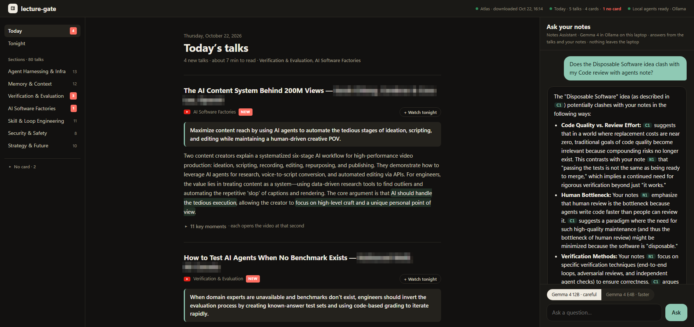

**By voice** (optional): start the page server with `--stt whisper`, then press the mic button and speak. Without the
flag there is no mic button and the Whisper model is never loaded. Whisper (`onnx-community/whisper-small` through transformers.js) turns
the speech into text on the laptop, so the audio never leaves it. Spoken questions are answered by code, without a
language model, so they come back fast:

- "What's new today?" / "What are the latest talks?" are read from the files the morning step wrote (`src/lib/quick.ts`).
- "Tell me more about … in today's talk" reads out the newest talk's three closest claims with their times and
  verified quotes.
- Any other question is answered from the search alone: the start of my closest note in my own words, plus up to two
  close talk claims with their quotes. The page server loads the search model at start so the first spoken
  question answers in under a second (smoke tests on Oct 24 measured about 0.2 to 0.6 s per answer).
- If nothing in the talks or my notes is close enough, the answer is a fixed "not in your notes" reply, and the
  question is saved to `data/open_questions.json` on the laptop. When a later talk seems to answer it, the morning
  merge flags it.

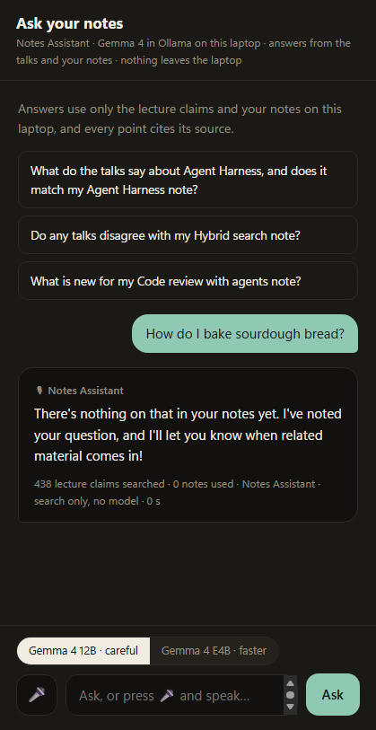

*Cropped to the chat panel.*

Answers are spoken with the browser's own voices by default. For the demo video, the page server can be started
with `--voices elevenlabs`; then the spoken answers are sent to ElevenLabs, and the page says so ("demo voices ON").
That mode is for the demo only.

## Privacy

- Personal notes are read only by models running in local Ollama. `src/cli/merge.ts` refuses any model that is not
  `ollama/...`.
- `notes/` and `data/` are gitignored; only public talk data goes to MongoDB Atlas.
- Voice (only with `--stt whisper`) is transcribed on the laptop; the Whisper weights are downloaded once.
- Exceptions, so you know exactly what goes out from the laptop: the morning pull from Atlas; in ElevenLabs demo
  mode, the spoken answer text; and while a slow spoken answer is loading, the page server fetches the weather from
  Open-Meteo, only when started with `--city <name>` (only the city name is sent), for the host's waiting lines, and also requests the Hacker News top
  stories (see the last limit below).

## Stack

- **Models (all open weights)**: Google Gemma 4 31B on DigitalOcean serverless inference (server); Gemma 4 12B / E4B
  and EmbeddingGemma in Ollama (laptop); BAAI bge-m3 embeddings (server); Whisper small via transformers.js (laptop, optional).
- **Orchestration**: Mastra workflow on Temporal (`@mastra/temporal`), systemd units on a DigitalOcean Droplet.
- **Data**: MongoDB Atlas with Vector Search; SerpApi for transcripts; Backboard for the tested prompt rules;
  Sentry for errors and model-call timings on the server (only timings and token counts, never prompts or outputs).
- **Language**: TypeScript on Node 22, run with `tsx`.

## Numbers (checked against the data in this repo on 2026-10-24)

- 92 talks with a card, 352 concept pages in 7 categories.
- 386 of 432 quotes (89%) were found word for word in their transcript; only those are shown.
- The morning merge on Oct 24 brought in 6 talks and added 25 new points, all to the category notes in
  `notes/sections/`.

## Run it

Node 22. Install with the lockfile and without install scripts:

```
npm ci --ignore-scripts
cp .env.example .env   # then fill it in
```

**Server**: `deploy/push.sh` copies the project to the Droplet, and `deploy/setup.sh` installs Node, the Temporal CLI
and the systemd units in `deploy/` (Temporal, worker, webhook, the watchdog every 3 hours, the Rule Tester at
03:00 UTC). The server needs `DO_MODEL_ACCESS_KEY`, `SERPAPI_API_KEY`, `MONGODB_URI`, `WEBSUB_SECRET` and
`CALLBACK_URL`; `SENTRY_DSN` and `BACKBOARD_API_KEY` are optional.

**Laptop**: install [Ollama](https://ollama.com) and pull `gemma4:12b` and `embeddinggemma`. `MONGODB_URI` is the
only key needed.

```
npx tsx src/cli/merge.ts --init       # first time: copy notes.sample/ into notes/ (your own notes go here)
npm run morning                       # pull from Atlas, merge into notes/, mark key phrases
npm run web                           # the morning page on http://127.0.0.1:4321
npm run ask -- "a question"           # the Notes Assistant in the terminal
```

`npm run web -- --stt whisper` turns on voice input. `npm run web -- --voices elevenlabs` turns on the demo voices (needs an ElevenLabs API key in `.env` as `ELEBENT_API_KEY`, the name the code reads).

## Where things are

| | |
|---|---|
| `src/mastra/` | the workflow (transcript → card → map) and its Temporal worker |
| `src/server/webhook.ts` | receives YouTube push notifications and starts the workflow |
| `src/lib/card.ts` | the card prompt, checks and revision loop |
| `src/agent/` | the concept map: batch build, adding one new talk, the nightly Rule Tester |
| `src/cli/` | one script per task; each file starts with what it does and its usage |
| `src/lib/ask.ts`, `src/lib/quick.ts` | typed and spoken answers |
| `src/lib/stt.ts` | Whisper on the laptop (optional, `--stt whisper`) |
| `docs/EXPERIMENTS.md` | the measurements behind each choice (models, thresholds) |
| `docs/ISSUES.md` | known problems |

## Limits and honest notes

- There are no automated tests yet.
- The typed Notes Assistant is slow on a laptop (minutes per answer), which is why spoken questions use search
  only.
- The similarity thresholds (0.45 for note matching and for reading a claim out as an answer) come from small
  experiments (`docs/EXPERIMENTS.md`); the 0.55 threshold for flagging answers to open questions was not tested on
  real questions.
- Whisper often mishears names and terms (for example, "approving alpha" for the talk "Proving Alpha", "age and harness"
  for "agent harness"), which is why voice input is off by default.
- The pipeline only takes new uploads from the subscribed channels; it does not backfill older talks.
- Talks narrated in Korean are skipped.
- `src/lib/fillers.ts` still fetches Hacker News headlines that are no longer read out.

## License

MIT © 2026 Sohee Lee
